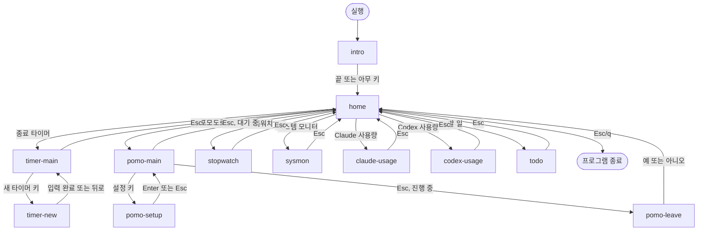

# 11_shutdown_timer — UX flow

[← Hub](README.md) · Prev: [2. Feature spec](02-spec.md) · Next: [5. Design system (DESIGN.md)](../DESIGN.md)

Created: 2026-11-05

<!-- wf:flow
status: done
-->

> Basis: [feature spec](02-spec.md). Done when: every Must feature appears in the flow and the user has confirmed → `status: done`

## At a glance

- 화면 12개: intro → home → 앱 7개(종료 타이머, 포모도로, 스톱워치, 시스템 모니터, Claude 사용량, Codex 사용량, 할 일). 어느 앱에서든 Esc 로 home 에 복귀
- 종료 타이머는 예약이 OS 에 걸려 있어서 나가도 유지됨 → home 목록에 예약 상태를 표시함
- 포모도로·스톱워치는 진행 중에 Esc 를 누르면 한 번 확인함. 모니터·사용량·할 일은 바로 나감

## Screen list

These become the stage 6 wireframe file names. A slug is lowercase letters, digits, and `-`.

| slug | Screen name | Related feature |
| --- | --- | --- |
| intro | 인트로 (로고, 부제목, 로딩 막대) | [F-01](02-spec.md#f-01) |
| home | 홈 메뉴 (앱 7개 한 줄 목록, 종료 타이머 예약 상태 표시) | [F-01](02-spec.md#f-01), [F-03](02-spec.md#f-03) |
| timer-main | 종료 타이머 (대기/예약됨, 큰 숫자, 진행률) | [F-02](02-spec.md#f-02) |
| timer-new | 종료 타이머 새 예약 입력 | [F-02](02-spec.md#f-02) |
| pomo-main | 포모도로 (대기/진행/일시정지, 구간·횟수 표시) | [F-04](02-spec.md#f-04) |
| pomo-setup | 포모도로 집중/휴식 분 설정 | [F-04](02-spec.md#f-04) |
| pomo-leave | 포모도로 나가기 확인 (진행 중일 때만) | [F-04](02-spec.md#f-04) |
| stopwatch | 스톱워치 (큰 숫자, 랩 목록, 나가기 확인) | [F-10](02-spec.md#f-10) |
| sysmon | 시스템 모니터 (CPU·메모리·디스크 막대, 추이) | [F-07](02-spec.md#f-07) |
| claude-usage | Claude Code 사용량 (기간 탭, 합계, 모델별, 일별 막대) | [F-08](02-spec.md#f-08) |
| codex-usage | Codex 사용량 (claude-usage 와 같은 구성) | [F-09](02-spec.md#f-09) |
| todo | 할 일 목록 (목록, 추가 입력, 빈 상태) | [F-11](02-spec.md#f-11) |

## Overall flow

- 각 화면 안의 자기 반복(취소, 시작·일시정지, 기간 전환, 새로고침, 항목 추가·삭제 등)은 그림에서 생략했고 와이어프레임의 상태별 변형에 그려 둠
- `pleave` 의 "아니오" 는 pomo-main 으로, "예" 는 home 으로 감. 스톱워치도 측정 중 Esc 에서 같은 확인을 거침 (stopwatch 화면의 상태로 그림)
- 노드가 20개 이하라 한 장으로 둠 (14개)

## Core task paths

| Feature | Start screen | Path | Exit/exception branches |
| --- | --- | --- | --- |
| [F-01](02-spec.md#f-01) | [home](06-wireframe/home.html) | home → 앱 선택 → 앱 화면 → Esc → home | 앱 0개면 "등록된 앱 없음" 표시, home 에서 Esc/q 로 종료 |
| [F-02](02-spec.md#f-02) | [home](06-wireframe/home.html) | home → timer-main → timer-new → timer-main(예약됨) → 취소 → timer-main(대기) | 잘못된 입력은 timer-new 에 남아 안내, 예약 실패는 메시지 표시, 나가도 예약 유지 |
| [F-04](02-spec.md#f-04) | [home](06-wireframe/home.html) | home → pomo-main(25/5 대기) → 시작 → 구간 종료·전환 → Esc → home | 설정 값 오류는 pomo-setup 에서 거부, 진행 중 Esc 는 pomo-leave 확인 |

## Check

- Must 기능 중 F-03(앱 등록 구조), F-05(exe 배포)는 개발·배포 기능이라 사용자 화면이 없음 → 화면 흐름 대상 아님. F-06(macOS/Linux)도 화면 변화가 없음
- 새 앱 5개(F-07~F-11)는 핵심(Core) 기능이 아니라서 사용성 테스트 과제에는 넣지 않음
- 도달할 수 없는 화면과 막다른 화면은 없음 (모든 화면에서 home 으로 돌아올 수 있음)
- 앱이 7개라 home 목록은 한 줄형으로 바꿔야 함 (DESIGN.md 의 List item 에 변형 추가)
